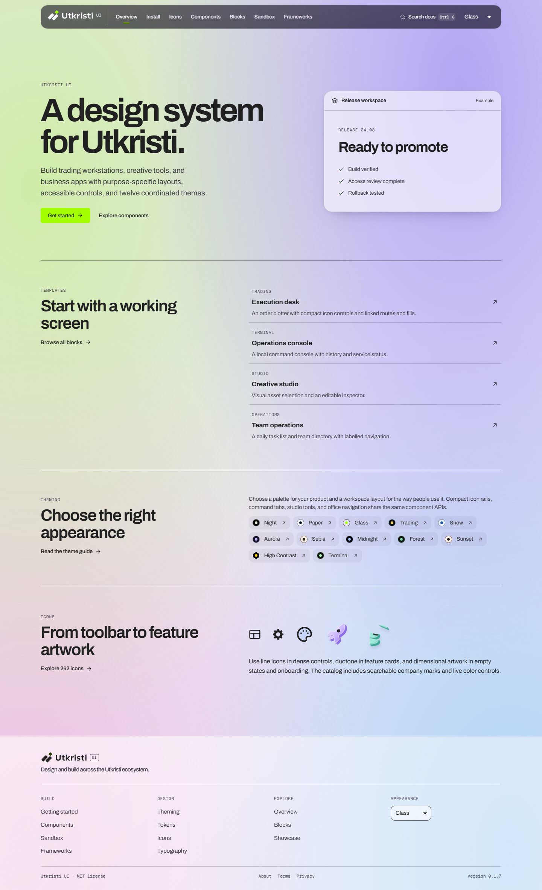

# Utkristi UI

Typed React components, theme-aware CSS and a Tailwind preset for building trading desks, creative
tools and business apps across the Utkristi ecosystem. It has the same look as Utkristi CoLabs:
condensed display type, hairline borders, pill controls and one cool accent, in twelve themes.

[Docs](https://utkristi-ui.vercel.app/) · [Sandbox](https://utkristi-ui.vercel.app/#/sandbox) ·
[Blocks](https://utkristi-ui.vercel.app/#/blocks) · [Changelog](CHANGELOG.md)



## Three ways to use it

| You use | Import | You get |
| --- | --- | --- |
| **React** | `@utkristi/ui` | Accessible, typed components (keyboard support, focus management, themes) |
| **Tailwind CSS** | `@utkristi/ui/preset` or `@utkristi/ui/plugin` | Component classes plus theme-aware colour, font, radius and easing utilities |
| **Plain HTML/CSS** | `@utkristi/ui/utkristi-ui.css` | The same classes with no build step; works in Vue, Svelte, Angular and static HTML |

All three use the same `--ut-*` CSS variables, so they mix freely.

## Motion, live interfaces and agent tools

- [Theme Studio](https://utkristi-ui.vercel.app/#/theme-studio) previews, shares, and exports generated themes. Import `@utkristi/ui/tokens.json` for the built-in DTCG token sets.
- Copy `@utkristi/ui/style-dictionary.config.json` next to a `tokens.json` export to generate CSS variables with Style Dictionary. [Style Dictionary configuration](https://styledictionary.com/reference/config/)
- Tabs, segmented controls, steps, theme changes, and docs navigation use View Transitions where supported. The kit respects reduced motion and uses native popovers and dialogs with keyboard and placement fallbacks.
- [Collaboration](https://utkristi-ui.vercel.app/#/components/collaboration), [live data](https://utkristi-ui.vercel.app/#/components/live-data), and [accessibility preferences](https://utkristi-ui.vercel.app/#/components/accessibility-preferences) have interactive examples.
- Import `@utkristi/ui/elements` to register light-DOM custom elements, or install a block through its version-pinned registry item.
- Run `npm run build:mcp` to build the local MCP server. The [MCP setup guide](packages/ui-mcp/README.md) describes its six tools. The docs build generates `llms.txt`, `llms-full.txt`, and per-component Markdown from the same catalog.

## Install

```sh
npm install @utkristi/ui
```

React 18+ and `lucide-react` are optional peer dependencies. You only need them for the React
components and for icons in your own code.

### React

```tsx
import { Button, ThemeProvider } from '@utkristi/ui';
import '@utkristi/ui/fonts.css';
import '@utkristi/ui/utkristi-ui.css';

export function App() {
  return (
    <ThemeProvider>
      <Button variant="solid">New workspace</Button>
    </ThemeProvider>
  );
}
```

Interactive components are marked `'use client'`, so you can import them straight into Next.js App
Router server components. Static ones (`Card`, `Badge`, `Kbd`, `Stat`, `Typography`, and similar)
render on the server with no client JavaScript. To avoid a flash of the wrong theme, render
`themeScript()` in an inline `<script>` in `<head>`.

### Tailwind CSS 3.4

```js
// tailwind.config.js
import preset from '@utkristi/ui/preset';

export default {
  content: ['./src/**/*.{html,js,jsx,ts,tsx}', './node_modules/@utkristi/ui/dist/**/*.js'],
  presets: [preset],
};
```

- **CommonJS:** use `presets: [require('@utkristi/ui/preset')]`.
- **Plugin only:** use `plugins: [utkristi()]` with `import utkristi from '@utkristi/ui/plugin'`.
  `utkristi({ base: false })` keeps the tokens but skips global base styles.
### Tailwind CSS 4

```css
@import "tailwindcss";
@import "@utkristi/ui/tailwind.css";
```

The file is written in Tailwind 4's own CSS API (`@theme`, `@custom-variant`, `@utility`, `@layer`)
and already includes the kit's compiled React files as a `@source`. It gives the same colour, font,
radius, shadow and easing utilities, the same theme variants (`light:`, `glass:` and so on) and the
same component classes as the v3 preset. Checked with Tailwind 4.3. Don't load
`@utkristi/ui/plugin` with `@plugin` in v4: it's for v3 only.

### Plain CSS

```html
<link rel="stylesheet" href="https://unpkg.com/@utkristi/ui/dist/fonts.css">
<link rel="stylesheet" href="https://unpkg.com/@utkristi/ui/dist/utkristi-ui.min.css">

<button class="btn btn-solid" type="button">New workspace</button>
```

| File | Use it when |
| --- | --- |
| `utkristi-ui.css` / `.min.css` | The default full stylesheet. |
| `utkristi-ui.layered.css` / `.layered.min.css` | You want your own CSS to win. Everything sits in `@layer utkristi.*`, so any unlayered rule in your app overrides the kit without `!important`. |
| `css/core.css` + `css/<component>.css` | You use only a few components. `core.css` holds the tokens, base and type helpers; add files such as `css/button.css`, `css/forms.css` or `css/menu.css`. `css/manifest.json` lists them all. For example, core plus button is about 11 KB gzipped, against 25 KB for the full sheet. |
| `scoped.css` | You're embedding the kit in an existing app. Styles apply only inside `[data-ut-scope]`. |
| `tokens.css` | You only want the CSS variables. |
| `@utkristi/ui/dom` | You want behaviour (`initUI(root)` for native dialogs and tabs) without React. |

The raw token values for every theme can be imported from `@utkristi/ui/tokens`: `night`, `paper`,
`glass`, `trading`, `snow`, `aurora`, `sepia`, `midnight`, `forest`, `sunset`, `highContrast` and
`terminal`.

## Themes

Night is the default. Set `data-theme` (or the matching class) on `<html>` or on any section:

| Theme | `data-theme` | Look |
| --- | --- | --- |
| Night | `dark` | Near-black film, warm ink, cool blue accent |
| Paper | `light` | Paper and navy ink |
| Glass | `glass` | Frosted translucent surfaces over a colour field |
| Trading | `trading` | Dense terminal, amber accent, market up/down colours |
| Snow | `snow` | Cool whites with light frost |
| Aurora | `aurora` | Dark glass with northern-lights colour |
| Sepia | `sepia` | Warm reading paper |
| Midnight | `midnight` | True black for OLED screens |
| Forest | `forest` | Calm dark green |
| Sunset | `sunset` | Warm peach and rose |
| High Contrast | `high-contrast` | 7:1 contrast, 2px borders, no translucency |
| Terminal | `terminal` | Retro green phosphor, monospace |

`data-theme="system"` follows the OS between Night and Paper. `ThemeProvider` saves the choice and
`ThemeSwitch` / `ThemeSelect` / `ThemeToggle` let people change it.

To rebrand a theme, override `--ut-*` variables. For small per-theme tweaks, Tailwind has a variant
per theme (`light:`, `night:`, `glass:`, `trading:` and so on).

### Make your own theme

The Theme Engine turns one brand colour into a complete theme. It defines every token a built-in
theme has, including the icon palette, and solves each text, control and focus pair in OKLCH until
it meets WCAG 2 contrast, so it cannot output a failing pair.

```sh
npx @utkristi/ui theme --brand "#7C3AED" --name violet --scheme dark > violet.css
npx @utkristi/ui theme --brand "#7C3AED" --name violet --scheme light --contrast AAA --format dtcg --out violet.tokens.json
```

```ts
import { createTheme, toCSS, toDTCG, toTailwindV4 } from '@utkristi/ui/theme-engine';

const violet = createTheme({ brand: '#7C3AED', name: 'violet', scheme: 'dark', contrast: 'AA' });
violet.report;      // every checked pair with its ratio and target
toCSS(violet);      // .violet, [data-theme="violet"] { … }
toTailwindV4(violet); // adds a `violet:` variant
toDTCG(violet);     // Design Tokens (Tokens Studio, Style Dictionary, Figma importers)
```

Use the theme with `data-theme="violet"`. For the React theme switcher, add it to the list in
`src/react/theme/themes.ts`. The tests generate 1,300 random brand themes on every run and require
zero contrast failures.

**Shape, density and motion** can be set on any section:
- `data-ut-radius="square" | "soft" | "round" | "pill"`.
- `data-ut-density="compact" | "comfortable"`.
- `data-ut-motion="fade" | "rise" | "scale" | "slide" | "none"`, with `data-ut-enter` on the region
  that animates in.

## Accessibility

- **Keyboard and focus.** Menus, tabs, segmented controls, steps and tables support the keyboard.
  Dialogs and the mobile menu trap and restore focus.
- **Contrast.** Contrast is tested for every theme. Text pairs reach 4.5:1 or more; borders, focus
  rings and graphics reach 3:1 or more.
- **System preferences.** Animations respect `prefers-reduced-motion`. Glass and the other
  translucent themes switch to opaque surfaces under `prefers-reduced-transparency`. Forced colours
  (Windows High Contrast) are supported.
- **Automated checks.** The test suite runs axe-core on the catalog examples.
- **Right-to-left.** Component CSS uses logical properties, so layouts mirror under `dir="rtl"`. Code
  blocks, keyboard keys and sliders stay left-to-right on purpose. A test blocks new physical
  `left`/`right` properties.

Browser support: the CSS uses `color-mix()`, so it needs Chrome/Edge 111+, Safari 16.2+ or
Firefox 113+.

## Size compared with other libraries

These are gzipped sizes for the same six components (button, dialog, menu, tabs, tooltip, select).
Each library is bundled the same way: esbuild, minified, React left out. Measured 2026-11-22.

| Library | JS | CSS | Total |
| --- | --- | --- | --- |
| **Utkristi UI 0.1.7** | **6.5 KB** | 13.7 KB (includes all 12 themes) | **20.2 KB** |
| shadcn/ui (Radix primitives) | 42.5 KB | Tailwind classes in your app | 42.5 KB + your CSS |
| React Aria Components 1.22 | 66.2 KB | Unstyled, you write it | 66.2 KB + your CSS |
| MUI 6.5 | 70.4 KB | CSS-in-JS (in the JS) | 70.4 KB |
| Mantine 7.17 | 60.2 KB | 11.3 KB | 71.5 KB |
| Ant Design 5.29 | 157.9 KB | CSS-in-JS (in the JS) | 157.9 KB |

**Caveat:** Utkristi's `Select` is a styled native `<select>`. The others build a custom listbox,
which costs more and does more. Utkristi's equivalent of that is `Combobox`. Per-component figures
are on the docs overview. To reproduce, see `scripts/compare-competitors.mjs`.

## What's included

- **Components:** buttons, split buttons, forms (Field, Combobox, DatePicker, date ranges, file
  drop), overlays (Modal, Menu, Popover, Tooltip, Toast), navigation (Navbar, Sidebar, Tabs,
  Breadcrumb, Pagination), data (Table and DataTable with remote state, selection, editing and
  virtualisation), layout (Shell, Workspace, Resizable), conversation, questionnaire, video and
  more. The [coverage inventory](docs/component-coverage.md) lists every example.
- **Blocks:** complete screens, including a project worklist, audit explorer, roles and access,
  trading and terminal workspaces, a landing page and pricing.
- **Icons:** about 256 glyphs in line, filled, duotone, 2.5D and 3D, with an icon colour palette
  for every theme (`@utkristi/ui/icons`).

Known gaps are listed in the [design review](docs/component-design-review.md), and the roadmap is
in [docs/planning/INNOVATION_PLAN.md](docs/planning/INNOVATION_PLAN.md).

## Development

```sh
npm ci
npm run build
npm test
npm run docs
```

| Command | Purpose |
| --- | --- |
| `npm run build` | Icons, CSS, Tailwind preset and plugin, React and type declarations |
| `npm test` | Vitest suite (builds the assets first) |
| `npm run lint` / `npm run typecheck` | ESLint and TypeScript |
| `npm run docs` / `docs:build` / `docs:preview` | Docs dev server, production build and local preview (icons are generated first) |
| `npm run check:bundles` | Bundle size budgets |
| `npm run smoke:package` | Packs the library and installs it into a test project |
| `npm run screenshots` | Headless Edge screenshots and responsive checks (falls back to Playwright) |
| `npm run docs:audit` / `docs:verify` / `docs:stress` | Catalog coverage, browser checks and sandbox stress run |
| `npm run bench` | Performance benchmarks |
| `npm run icons` / `icons:3d` | Rebuild icons (the 3D renders need Python and Blender) |

The docs build to `docs/dist` and deploy on Vercel with the included `vercel.json`. They use hash
routes, so any static host works.

## More

- [Design tokens and class map](DESIGN_TOKENS.md)
- [Migration guide](MIGRATION.md)
- [Support and compatibility](SUPPORT.md)
- [Changelog](CHANGELOG.md)
- Planning briefs (build, icons, themes, enterprise, innovation) in [docs/planning](docs/planning)
- [MIT license](LICENSE)
