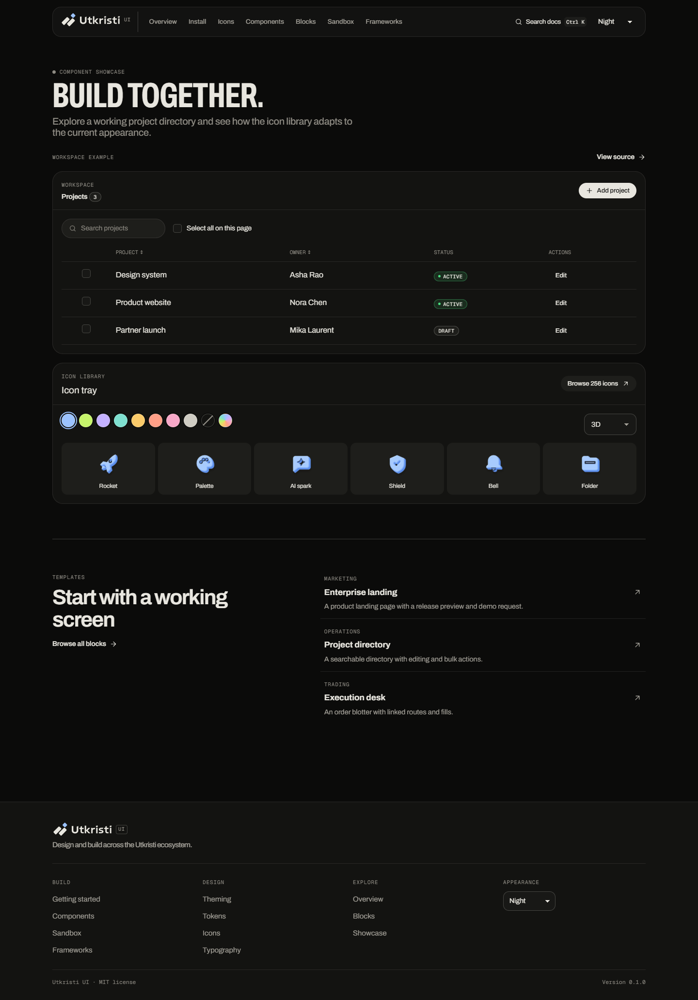
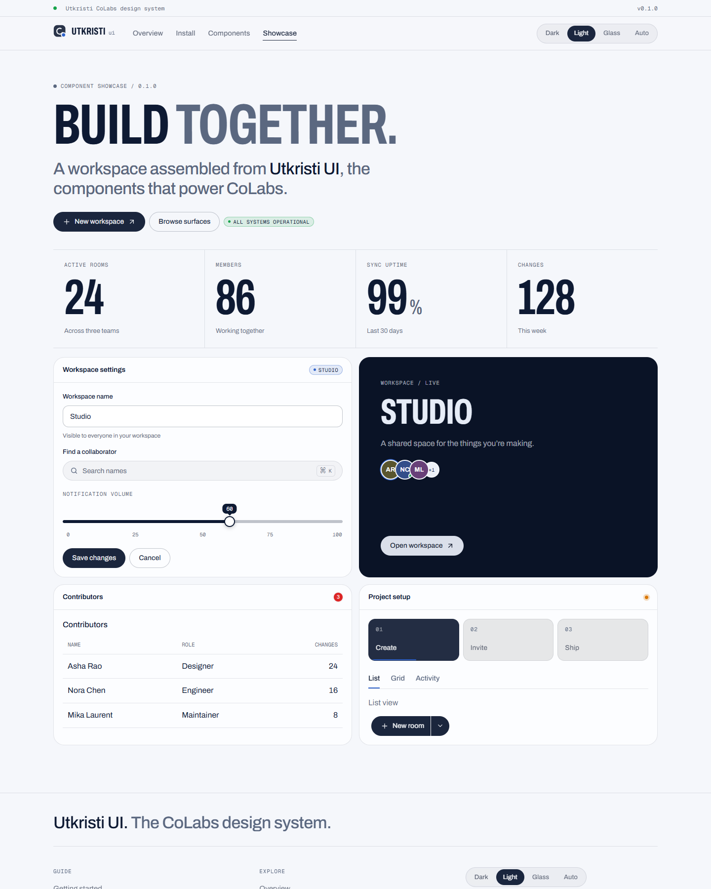
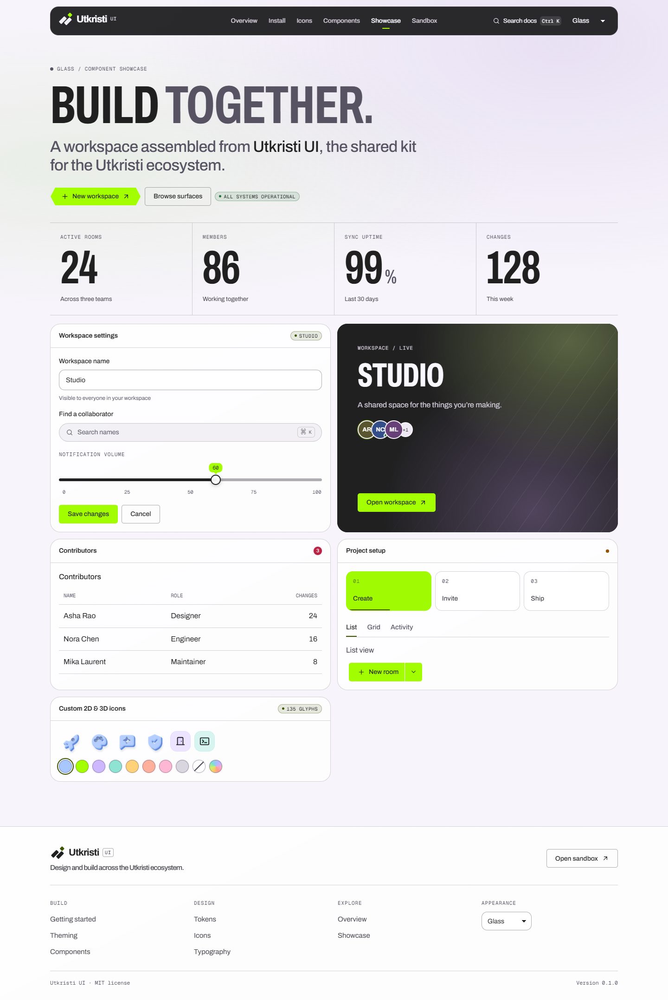
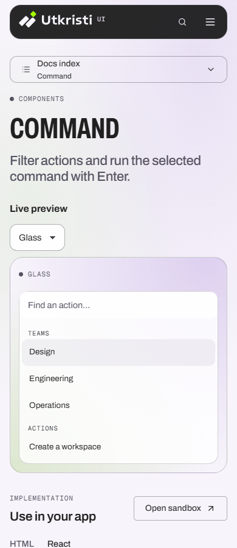
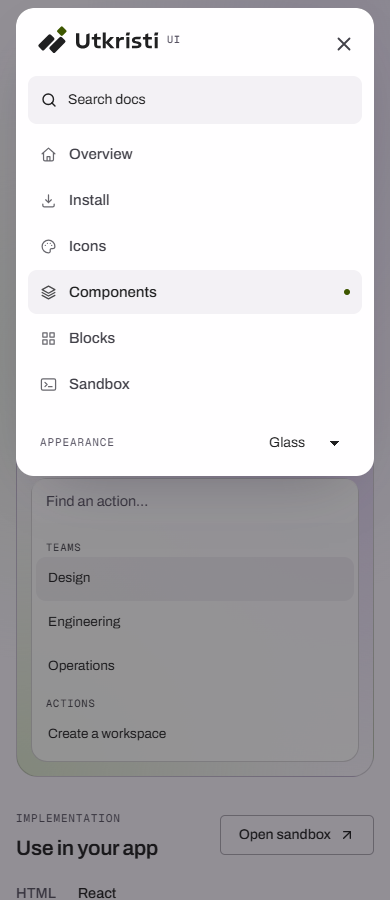

# Utkristi UI

Utkristi UI is the shared design system for the Utkristi ecosystem. It includes Night, Paper, and Glass themes, CSS custom properties, a Tailwind CSS 3.4 preset and plugin, a standalone stylesheet, and typed React components.

[Marketing overview preview](docs/screenshots/overview.png)

[Icon catalog preview](docs/screenshots/icons.png)

| Night | Paper | Glass |
| --- | --- | --- |
|  |  |  |

| Mobile docs | Mobile navigation |
| --- | --- |
|  |  |

The docs include component variants and a Blocks library with working project management, account, settings, and pricing examples. Open any example in the sandbox to try it in Night, Paper, or Glass.

## Install

```sh
npm install @utkristi/ui
```

For local development, run `npm pack` in this repository and install the resulting tarball in the consuming project.

### Tailwind CSS 3.4

```js
// tailwind.config.js
import preset from '@utkristi/ui/preset';

export default {
  content: ['./src/**/*.{html,js,jsx,ts,tsx}', './node_modules/@utkristi/ui/dist/**/*.js'],
  presets: [preset],
};
```

In CommonJS, use `presets: [require('@utkristi/ui/preset')]`. To load only the plugin, use `plugins: [utkristi()]` with `import utkristi from '@utkristi/ui/plugin'`. Pass `{ base: false }` to skip the global base styles and keep the tokens. Include Tailwind's base, components, and utilities layers in your CSS.

For Tailwind CSS 4, load the legacy configuration with `@config` or load the plugin directly with `@plugin "@utkristi/ui/plugin"`. Use `@source` to include the kit's compiled React files. [Tailwind compatibility directives](https://tailwindcss.com/docs/functions-and-directives#compatibility)

### Standalone CSS

```js
import '@utkristi/ui/fonts.css';
import '@utkristi/ui/utkristi-ui.css';
```

The stylesheet is also available as `@utkristi/ui/css` or `@utkristi/ui/utkristi-ui.min.css`. Use `@utkristi/ui/tokens.css` for just the CSS variables, or import `night`, `paper`, and `glass` from `@utkristi/ui/tokens` for raw values.

```html
<button class="btn btn-solid" type="button">New workspace</button>
```

### React

```tsx
import { Button, ThemeProvider } from '@utkristi/ui';
import '@utkristi/ui/utkristi-ui.css';

export function App() {
  return (
    <ThemeProvider>
      <Button onClick={() => console.log('Create workspace')}>New workspace</Button>
    </ThemeProvider>
  );
}
```

React and React DOM 18 or later are peer dependencies. Pass icons as React nodes. The kit ships its own icons for internal controls.

## Themes and accessibility

Night is the default. Set `data-theme="light"` for Paper, `data-theme="dark"` for Night, or `data-theme="glass"` for Glass. Use `data-theme="system"` to follow the operating-system preference for Night and Paper. These selectors also work on nested surfaces. `ThemeProvider` persists the preference and applies the resolved theme to the root. Render `themeScript()` in the document head to set the theme before paint. Override `--ut-*` variables to customize a theme and use the `light:`, `night:`, and `glass:` Tailwind variants for local adjustments.

Menus, tabs, segmented controls, and dialogs support keyboard navigation. Dialogs trap and restore focus. Decorative animations respect reduced motion, and the spinner keeps moving as a loading cue. The Night theme uses dark `--ut-on-bad` text on red fills to meet the 4.5:1 text contrast target.

The standalone CSS requires `color-mix()`. Use Chrome or Edge 111+, Safari 16.2+, or Firefox 113+.

## Component catalog

The docs show the component catalog in Night, Paper, and Glass. Use React for stateful behavior or the CSS classes and Tailwind utilities to build native HTML compositions. Utkristi’s components have their own APIs and reuse the same theme tokens across apps.

Use `Typography` with `typeface="archivo"`, `"geist"`, `"inter"`, `"manrope"`, or `"serif"` (Newsreader). Import `@utkristi/ui/fonts.css` to load the web fonts, or override the font tokens for your app. Tailwind also exposes `font-geist`, `font-inter`, `font-manrope`, and `font-serif`.

## Docs and hosting

Run `npm run docs` to open the documentation. Each component page includes interactive previews, copyable code, and a prop reference. The Sandbox runs editable TSX or HTML in a separate preview and lets you test any theme.

The Sandbox offers Fit, Phone, and Tablet preview widths. Add `ut-scrollbar` to an existing scroll container to style its native scrollbar, or use `ScrollArea` to add a keyboard-focusable scroll region. The scrollbar follows the theme and keeps system styling for touch and forced colours.

Build the website with `npm ci` and `npm run docs:build`. Publish the contents of `docs/dist` with your static host. The site uses relative asset paths and hash routes, so a subdirectory works without a server rewrite. Run `npm run docs:preview` to verify the production build locally.

## Performance verification

Component source and prop tables load when opened. The sandbox and its compiler load separately from the main docs. The production build serves about 142 KB of gzipped JavaScript for the main docs.

Run `npm run docs:stress` to repeat the Edge check. The local run checked 93 routes in each theme at 375px and exercised 12 sandbox runs at 4× CPU throttling with 5,000 table rows or 60 carousel slides. Run-to-preview latency was 215 ms median and 393 ms p95 on the test machine. The editor reported invalid TSX and recovered on the next valid run.

[React code splitting](https://react.dev/reference/react/lazy) · [Long tasks and main-thread work](https://web.dev/articles/optimize-long-tasks) · [Animation rendering](https://web.dev/articles/animations-guide)

See the [competitive audit and implementation roadmap](docs/competitive-audit.md) for gaps across app workflows, distribution, accessibility, and performance.

## Development

| Command | Purpose |
| --- | --- |
| `npm run build` | Build CSS, Tailwind, React, and declarations |
| `npm test` | Run the test suite after building |
| `npm run lint` | Lint the workspace |
| `npm run typecheck` | Check TypeScript |
| `npm run docs` | Start the Vite documentation server |
| `npm run docs:build` | Build the documentation |
| `npm run docs:preview` | Preview the documentation build |
| `npm run docs:stress` | Run browser checks and exercise repeated sandbox runs under CPU throttling |
| `npm run screenshots` | Capture all three themes in headless Edge, sweep every docs route at 375px, and check key pages from 320px to 1440px |
| `npm run screenshots:capture` | Refresh the overview, the three showcases, and the two mobile screenshots |

The screenshot script uses Playwright with Chromium when Edge is unavailable. Install them in that environment before running the script.

[Design tokens and class map](DESIGN_TOKENS.md) · [Changelog](CHANGELOG.md) · [MIT license](LICENSE)
